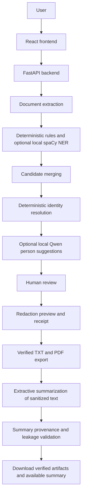

# PrivyDoc architecture

PrivyDoc is a local-first document review and release tool for Thilli AI Hackathon, Problem Statement 3. React and TypeScript run in the browser. A single FastAPI process on loopback serves the production build and handles document processing with PyMuPDF and optional spaCy. Vite proxies API calls to the same backend during development.

| Component | Responsibility |
| --- | --- |
| `frontend/src/main.tsx` and `ReviewWorkspace.tsx` | Upload, source highlights, evidence, mention and link decisions, manual selections, preview, artifact downloads |
| `frontend/src/review.ts` | Unicode code-point segmentation, exact-occurrence actions, keyboard handling |
| `privydoc/api.py` | Bounded requests, review lifecycle, complete decision validation, preview receipts, release coordination |
| `privydoc/documents.py` | Extraction, span replacement, independent TXT/PDF verification, extractive ranking |
| `privydoc/detection.py` | Deterministic regex and context rules, optional spaCy NER, same-type exact-span evidence merging |
| `privydoc/identity.py` | Deterministic document-local identity proposals and separate treatment of ambiguous references |
| `privydoc/ollama_detection.py` | Optional upload-only Qwen calls on loopback, validation, and source grounding for standalone person suggestions |
| `privydoc/summary_privacy.py` | Summary provenance, known values, direct identifier patterns, and quasi-identifier checks |

The identity resolver uses compatible name forms, nearby context, and competing anchors to propose links. spaCy supplies NER spans and evidence. Optional Qwen suggestions enter review after baseline linking. They cannot create or change identity links. A user resolves links and decides whether to redact each mention. Summarization ranks and selects excerpts from verified sanitized text using local code.

See [data flow](DATA_FLOW.md), [security assumptions](SECURITY.md), and [evaluation](EVALUATION.md).
